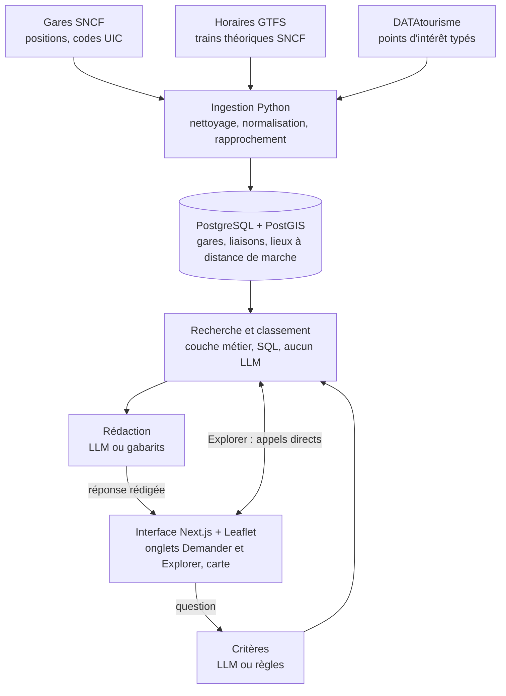

# Cadrage — Plateforme de tourisme ferroviaire

5 octobre 2026 · Hugo

Le socle tourne de bout en bout : ingestion, base PostGIS, API métier, recherche en langage naturel, carte. Les vraies données sont chargées depuis le 5 octobre : 329 gares, 5 816 liaisons directes, 58 362 points d'intérêt. Un modèle local a été branché et mesuré : trop lent et moins précis que les règles sur un portable sans carte graphique. Il reste à mesurer un modèle cloud.

Le fonctionnement du code, fichier par fichier, est décrit dans le [guide du code](GUIDE-DU-CODE.md).

## Périmètre retenu

Le prototype est une application web responsive, limitée à l'Auvergne-Rhône-Alpes, sans compte utilisateur.

- **Format** : option A du sujet. La carte domine sur grand écran ; sur mobile, elle passe au-dessus de l'assistant.
- **Territoire** : les douze départements de la région. La liste se réduit par configuration si l'ingestion ou la démonstration doit être allégée.
- **Destination** : une gare d'arrivée et les points d'intérêt situés à moins de 2 km d'elle. C'est le choix de modélisation qui relie le train au tourisme.
- **Transport** : trains seuls par défaut, cars activables. Une correspondance au maximum.
- **Personnalisation** : portée par la conversation en cours, sans profil enregistré, comme le demande le sujet.
- **Hors périmètre** : tout ce que le sujet exclut (comptes, historique persistant, réservation, back-office).

## Choix technologiques

Chaque brique est choisie pour tenir en trois jours et rester explicable en soutenance.

| Brique | Choix | Pourquoi | Alternative écartée |
| --- | --- | --- | --- |
| Interface | Next.js (React, TypeScript) | Une seule base de code pour ordinateur et mobile ; piste déjà envisagée par le groupe | Application mobile : build et démonstration plus lourds pour le même périmètre |
| Carte | Leaflet, fond OpenStreetMap | Libre, sans clé, suffisant pour des marqueurs et des tracés | MapLibre : rendu vectoriel plus riche, inutile à ce stade |
| API et logique métier | FastAPI (Python) | Même langage que l'ingestion et l'IA ; documentation interactive générée sur `/docs` | Routes API dans Next.js : scoring et extraction à réécrire en TypeScript |
| Base de données | PostgreSQL + PostGIS | Jointures relationnelles et calculs de distance dans le même moteur | Base documentaire : pas de jointure spatiale simple |
| Ingestion | Scripts Python, pandas | GTFS et CSV sont tabulaires ; tout se rejoue en une commande | Outil ETL dédié : trop lourd pour trois sources |
| LLM | Client compatible « OpenAI chat completions » | Le même code interroge un modèle local ou une API cloud : trois variables à changer | SDK propre à un fournisseur : fausse le comparatif |
| Tests | pytest | 69 tests, dont la chaîne complète sur un jeu d'essai |  |

Le choix de Python pour l'API reste à confirmer en groupe : il suppose que les étudiants AL acceptent d'écrire la couche métier dans ce langage.

## Architecture

Les étapes « Critères » et « Rédaction » sont confiées à un LLM s'il est configuré, sinon à des règles et à des gabarits.

La base est remplie une fois par l'ingestion. Chaque question traverse ensuite trois étapes, dont une seule décide des destinations : la couche métier, qui fonctionne sans LLM.

## Sources de données

Trois sources ouvertes alimentent la base, toutes téléchargeables sans compte ni clé.

| Source | Ce qu'on en tire | Format | Licence |
| --- | --- | --- | --- |
| [SNCF Open Data, gares de voyageurs](https://www.data.gouv.fr/datasets/gares-de-voyageurs-1) | Référentiel des gares : nom, position, code INSEE, codes UIC | JSON | ODbL |
| [Réseau SNCF TGV, Intercités et TER](https://transport.data.gouv.fr/datasets/horaires-sncf) | Horaires théoriques, d'où la durée et la fréquence entre deux gares | GTFS, 5,4 Mo | ODbL et conditions particulières |
| [DATAtourisme, export régional](https://www.data.gouv.fr/datasets/datatourisme-la-base-nationale-des-donnees-publiques-dinformation-touristique-en-open-data) | Points d'intérêt : nom, types, position, commune, description | CSV, 44 Mo, mis à jour chaque jour | Licence Ouverte 2.0 |
| OpenStreetMap | Fond de carte | Tuiles | ODbL |
| SNCF Open Data, six jeux de données sur les gares | Services : assistance PMR, équipements d'accessibilité, ascenseurs, vélo, points de vente, Wi-Fi | JSON | Licences à relever sur les fiches |
| SNCF Open Data, formes des lignes du Réseau Ferré National | Géométrie des lignes, pour tracer les trajets le long des rails | GeoJSON | Licence à relever sur la fiche du jeu de données |

Le GTFS publié est un flux national unique : il ne contient pas de fichier propre aux TER, d'où le filtrage sur les gares de la région. Sa période de validité court du 2 octobre 2026 au 31 mars 2027.

Les sources sont croisées deux fois : gares et arrêts GTFS par code UIC (à défaut, par proximité à moins de 300 m), gares et points d'intérêt par distance.

Non retenues pour lundi, utiles ensuite :

- **API DATAtourisme** (clé gratuite) : accès aux fiches complètes, dont la difficulté et la durée des itinéraires, absentes du CSV.
- **OpenStreetMap via Overpass** : sentiers et équipements autour des gares, pour affiner le temps de marche.
- **Apidae** : facultatif selon le sujet, et soumis à une clé.

## Modèle de données

Sept tables, dont trois calculées à l'ingestion pour que les recherches restent de simples jointures.

| Table | Contenu | Alimentée par |
| --- | --- | --- |
| `gare` | Gares de la région, avec leur position | SNCF Open Data |
| `gare_uic` | Codes UIC de chaque gare, pour le rapprochement avec le GTFS | SNCF Open Data |
| `liaison` | Durée médiane, nombre de trains par jour et tracé (par les arrêts du train, le long des voies si elles sont chargées) entre deux gares, en direct | GTFS |
| `accessibilite` | Liaison directe, ou meilleur trajet à une correspondance | Calcul SQL sur `liaison` |
| `poi` | Points d'intérêt, avec leurs thèmes internes et leurs types d'origine | DATAtourisme |
| `gare_poi` | Distance et minutes de marche entre une gare et un point d'intérêt | Calcul PostGIS |
| `import_journal` | Source, fichier, nombre de lignes et date de chaque import | Pipeline |

Trois hypothèses sont à savoir défendre :

- **Correspondance** : la durée est la somme des deux tronçons plus 15 minutes. Elle ignore les horaires réels de correspondance ; l'interface l'affiche comme une estimation.
- **Marche** : distance à vol d'oiseau multipliée par 1,3, à 4,5 km/h. Ce n'est pas un itinéraire piéton.
- **Thèmes** : dix thèmes internes, déduits des types DATAtourisme par mots-clés. Environ 15 % des lieux restent sans thème : des commerces et des services, écartés volontairement.

## Recherche en langage naturel

Le LLM traduit la question en critères et rédige la réponse ; il ne choisit jamais une destination.

1. **Extraction** : la question devient six critères (origine, durée de trajet, durée de marche, thèmes, public, difficulté). Par LLM s'il est configuré, sinon par règles.
2. **Validation** : un modèle Pydantic écarte tout thème inconnu et toute valeur hors bornes.
3. **Mémoire** : les critères du message précédent sont renvoyés par le navigateur et fusionnés. Le serveur ne garde aucun état.
4. **Recherche** : en SQL, les gares accessibles dans le temps donné, puis leurs points d'intérêt du bon thème à distance de marche.
5. **Classement** : une formule explicite, détaillée ci-dessous et affichée dans l'interface.
6. **Rédaction** : par gabarit, ou par le LLM qui ne reçoit que les destinations retenues.

| Composante du score | Poids | Calcul |
| --- | --- | --- |
| Thèmes demandés couverts | 35 % | Part des thèmes ayant au moins un lieu |
| Nombre de lieux correspondants | 20 % | Saturé à 5 lieux |
| Temps de trajet | 20 % | 1 − durée / durée maximale |
| Marche depuis la gare | 15 % | 1 − marche du lieu le plus proche / marche maximale |
| Fréquence des trains | 10 % | Saturée à 10 trains par jour |
| Correspondance | − 10 points | Par correspondance |

Garde-fous contre les réponses inventées :

- La ville de départ est recherchée dans la table des gares. Introuvable, l'application le dit et ne cherche pas.
- Le LLM renvoie une justification par identifiant de gare. Tout identifiant absent des résultats est jeté.
- Un critère que les données ne permettent pas de vérifier, comme la difficulté d'une randonnée, est signalé et non appliqué.
- Sans résultat, la réponse indique quelle contrainte assouplir et de combien.
- LLM en panne ou réponse illisible : repli automatique sur les règles et les gabarits.

Limite connue : le texte rédigé par le LLM n'est pas contrôlé mot à mot. Un modèle pourrait glisser un fait faux dans une phrase portant sur une vraie gare.

## Solution IA

Proposition : développer avec un modèle open source local servi par Ollama, et mesurer en parallèle un modèle cloud d'entrée de gamme avec le même script. La recommandation finale se décidera sur ces mesures, pas avant.

Le LLM fait deux appels courts par question : un pour extraire les critères, un pour rédiger. Chaque réponse de l'API renvoie la durée et les jetons consommés par appel, ce qui alimente directement le comparatif demandé pour mercredi.

| Critère du sujet | Comment le mesurer |
| --- | --- |
| Qualité des réponses | `python -m evaluation.evaluer` : critères conformes et contraintes respectées par requête |
| Temps de réponse | Durée médiane renvoyée par le même script, pour chaque modèle |
| Coût cloud | Jetons mesurés par requête × tarif du modèle × 5 000, 50 000 et 500 000 requêtes par mois |
| Coût auto-hébergé | Machine nécessaire (mémoire observée en local), hébergement mensuel, maintenance et supervision |
| Facilité d'intégration | Identique : trois variables d'environnement dans les deux cas |
| Confidentialité | Les questions ne portent ni compte ni donnée personnelle : à argumenter |

Les tarifs ne figurent pas ici : ils sont à relever sur les pages des fournisseurs le jour du comparatif, avec la date.

Un point à anticiper : les règles d'extraction obtiennent 9 sur 9 sur les requêtes du sujet, mais elles ont été écrites à partir de ces requêtes. L'apport réel du LLM ne se verra que sur des formulations nouvelles, à ajouter au jeu de test.

### Premières mesures

Mesures du 5 octobre, sur un portable sans carte graphique, avec 12 requêtes inédites.

|  | Règles seules | llama3.2:3b en local |
| --- | --- | --- |
| Critères conformes | 7 sur 12 | 3 sur 12 |
| Contraintes respectées dans les résultats | 12 sur 12 | 12 sur 12 |
| Temps médian par question | environ 40 ms | 92 secondes |
| Jetons par question | aucun | environ 1 800 en entrée, 250 en sortie |

Un modèle plus gros, Mistral 7B, dépassait le délai de 60 secondes sur la plupart des appels.

Trois enseignements pour le comparatif :

- **Besoins matériels** : l'auto-hébergement suppose un serveur avec carte graphique. Sur processeur seul, le temps de réponse n'est pas présentable.
- **Capacité** : à 92 secondes par question, une machine de ce type traite au mieux 940 questions par jour, soit environ 28 000 par mois. Elle ne tient pas le scénario à 50 000 requêtes.
- **Coût cloud** : nombre de requêtes × (1 800 × tarif d'entrée + 250 × tarif de sortie). Le décompte des jetons varie un peu d'un modèle à l'autre.

Le modèle se trompe sur les critères, mais tous les résultats affichés respectent les contraintes appliquées : les garde-fous tiennent.

## État des vérifications

L'ingestion a tourné sur les données réelles sans correction. Un modèle local a été mesuré ; il reste à mesurer un modèle cloud.

| Élément | Ce qui a été fait | Ce qui reste à vérifier |
| --- | --- | --- |
| Ingestion | Exécutée sur le jeu d'essai, puis sur les fichiers réels le 5 octobre | Les types DATAtourisme encore sans thème, listés par le pipeline |
| Requêtes SQL | Exécutées sur PostgreSQL avec un substitut de PostGIS | Rien : validées sur PostGIS lors du chargement réel |
| API et assistant | 69 tests passent ; des défauts introduits exprès sont bien détectés | Les temps de réponse sur la base complète |
| Appels au LLM | Testés contre un serveur simulé, puis avec deux modèles locaux servis par Ollama | Un modèle cloud |
| Interface | Lancée sous Next.js dans Docker, vérifiée à la main | Aucun test automatique de l'interface |
| Docker | Fichiers écrits | Rien : base, API et interface lancées avec Docker Compose |

Le jeu d'essai sert à développer. Il ne doit pas apparaître dans la démonstration, qui est notée sur des données réellement exploitées.

## D'ici mardi matin

L'objectif est de présenter la chaîne sur des données réelles, et que chaque membre sache l'expliquer.

- [ ] Remplir le tableur des équipes, avec les noms tels qu'écrits sur MyGes et l'option de chacun
- [ ] Créer le dépôt Git du groupe et y déposer le socle
- [x] Installer et lancer le socle sur une machine en suivant le README ; noter ce qui casse
- [x] Charger les vraies données (`python -m ingestion.pipeline --telecharger`) et lire le bilan étape par étape
- [x] Corriger les noms de colonnes si une étape retient zéro ligne ou rattache peu d'arrêts
- [ ] Contrôler à la main trois gares et cinq points d'intérêt contre les sources
- [x] Compléter la table des thèmes avec les types sans thème listés par le pipeline
- [x] Brancher un modèle local et lancer le script d'évaluation
- [x] Ajouter dix requêtes nouvelles au jeu de test
- [ ] Relire le code à plusieurs : ingestion, classement, rôle du LLM
- [ ] Répéter la démonstration de 10 minutes : `/stats`, l'onglet Explorer, une question, sa suite, un cas sans résultat

Pour mercredi : la mesure d'un modèle cloud, la difficulté des itinéraires via l'API DATAtourisme, le comparatif chiffré et les slides de synthèse.

## Points à trancher

- Le sujet demande « une slide technique unique » dans le déroulé de la soutenance, puis « 2 seules slides » dans la section suivante. Laquelle des deux consignes s'applique ?
- La FAQ du sujet et la vidéo de présentation n'ont pas été lues pour ce cadrage. Contiennent-elles des consignes supplémentaires ?
- Le groupe valide-t-il Python pour l'API, ou préfère-t-il tout garder dans Next.js ?
- Région entière, ou périmètre réduit à l'Isère et aux deux Savoie pour une démonstration plus maîtrisée ?
- Qui fournit la clé pour le modèle cloud du comparatif, et sur quel budget ?

## Sources

- [Sujet du projet](https://haudrey.notion.site/Projet-Plateforme-intelligente-de-tourisme-ferroviaire-e3d286ac2a568362a81b015fb6643ae6), cours d'Audrey Hossepian
- [Gares de voyageurs](https://www.data.gouv.fr/datasets/gares-de-voyageurs-1), fiche du jeu de données SNCF sur data.gouv.fr
- [Réseau SNCF TGV, Intercités et TER](https://transport.data.gouv.fr/datasets/horaires-sncf), transport.data.gouv.fr
- [Ressource GTFS SNCF](https://transport.data.gouv.fr/resources/83582) : adresse de téléchargement, validité, rapport de validation
- [DATAtourisme sur data.gouv.fr](https://www.data.gouv.fr/datasets/datatourisme-la-base-nationale-des-donnees-publiques-dinformation-touristique-en-open-data) : exports CSV et licence
- [L'API DATAtourisme](https://www.datatourisme.fr/2026/03/16/lapi-datatourisme-un-acces-direct-aux-donnees-touristiques/), annonce du 16 mars 2026
